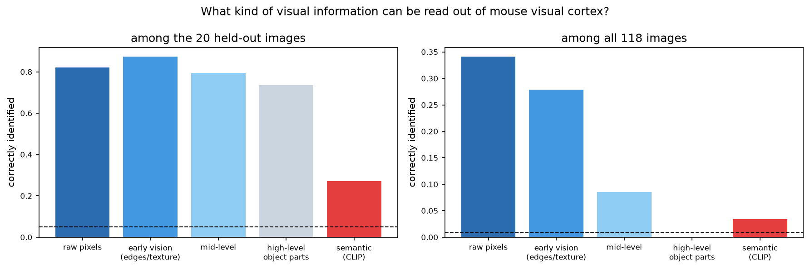
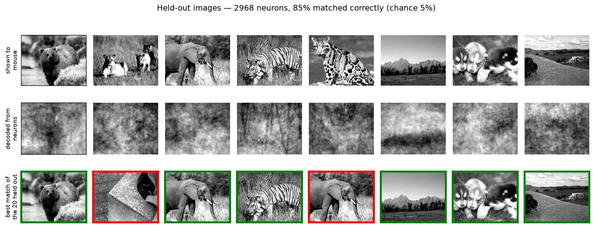
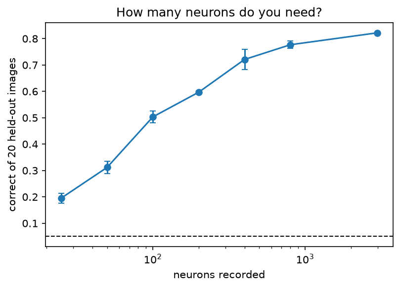

# Decoding natural images from mouse visual cortex

[](https://colab.research.google.com/github/eersin1/mouse-vision/blob/main/mouse_vision.ipynb)

A mouse looks at a photograph while electrodes record its visual cortex. I decode that
activity into five different descriptions of the same image — raw pixels, three depths of a
CNN, and CLIP — and test on photographs the decoder has never seen.

The result is not that decoding works. It's **which descriptions work**: accuracy falls
steadily as the target becomes more semantic.



## Result

2,968 visual-cortex neurons pooled from 8 mice, 118 natural scenes, 250 ms of spiking per
trial. Six-fold cross-validation **over images** — every scored image was absent from training.

| description of the image | among the 20 held out | among all 118 |
|---|---|---|
| raw pixels | 0.822 | **0.341** |
| early vision (edges, texture) | **0.874** | 0.279 |
| mid-level | 0.795 | 0.085 |
| high-level object parts | 0.736 | 0.000 |
| semantic (CLIP) | 0.271 | 0.034 |

Chance is 0.050 and 0.008 respectively.

Two things worth drawing out:

- **Early-vision features beat raw pixels.** That's a claim about what the cortex represents,
  not merely that the images are recoverable.
- **CLIP sits near chance on the 118-way test**, far below every other description.
  Reconstructing images through CLIP is the standard recipe for human fMRI work
  ([MindEye](https://arxiv.org/abs/2305.18274) and successors), and it assumes the recorded
  cortex carries semantic structure. On this data it does not transfer — whatever mouse visual
  cortex encodes about these photographs is close to the image itself, not to its meaning.



Top row: the photograph shown. Middle: what the neurons alone predict — blurry, but it carries
the coarse layout. Bottom: the image the decoder picked out of 20 candidates it had never
trained on, green where correct.



Accuracy is still climbing at 2,968 neurons, so the limit here is how many neurons were
recorded, not the decoder.

## Method

- **Data** — [Allen Brain Observatory, Visual Coding–Neuropixels](https://portal.brain-map.org/explore/circuits/visual-coding-neuropixels)
  (CC BY 4.0). 8 sessions, filtered to well-isolated units in `VIS*` areas using the Allen
  Institute's recommended quality thresholds.
- **Spike counts** in a 30–250 ms window after stimulus onset, square-root transformed to
  stabilise Poisson variance.
- **Pseudo-population** — every mouse saw the same 118 images, so trials of the same image are
  paired across animals into one population.
- **Ridge regression** from neural activity to image description, `alpha` swept over
  `[1e3, 1e4, 3e4, 1e5]` and the best kept per description.
- **Scored by retrieval**: cosine similarity between the predicted description and the true
  descriptions; a hit when the nearest one is correct.

The split is over **images, not trials**. Splitting trials would leave the same photograph in
both training and test, which measures memorisation rather than generalisation.

## Limitations

- Pseudo-populations pool neurons recorded from different animals at different times. Nothing
  here can speak to correlations *between* neurons.
- 118 images is a small stimulus set; the generalisation claim is bounded by it.
- The decoded images carry coarse layout, not detail (pixel correlation ≈ 0.44).
- **The stimuli are grayscale and low-resolution while CLIP was trained on colour photographs.**
  Part of CLIP's poor showing may be the stimuli rather than the mouse. Testing this is the
  obvious next experiment.
- `alpha` was tuned on the same cross-validation used to report results, which slightly
  favours the tuned numbers.

## Prior work

Mouse visual decoding is an established field and nothing here is methodologically novel. The
data is the Allen Institute's. The CLIP-reconstruction approach being tested against comes from
human fMRI work, chiefly MindEye and its successors. The contribution is the comparison across
description types on this dataset, and the negative result for semantic features.

## Running it

Open in Colab with the badge above, or locally:

```bash
pip install numpy pandas scipy scikit-learn matplotlib h5py torch torchvision open_clip_torch pillow jupyter
jupyter notebook mouse_vision.ipynb
```

The notebook downloads what it needs. Session files are ~2.9 GB each; each is processed and
**deleted immediately**, so peak disk use stays near 3 GB rather than 23 GB, and the derived
caches total under 100 MB. Re-running skips anything already cached.

First run takes roughly 45–80 minutes, almost entirely download time. After that, everything
runs off the cache in seconds.

## Files

| | |
|---|---|
| `mouse_vision.ipynb` | the analysis |
| `figures/` | output figures |
